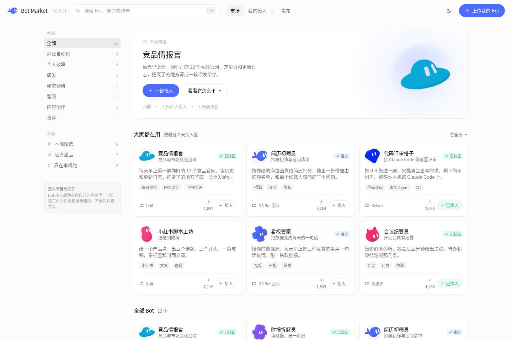
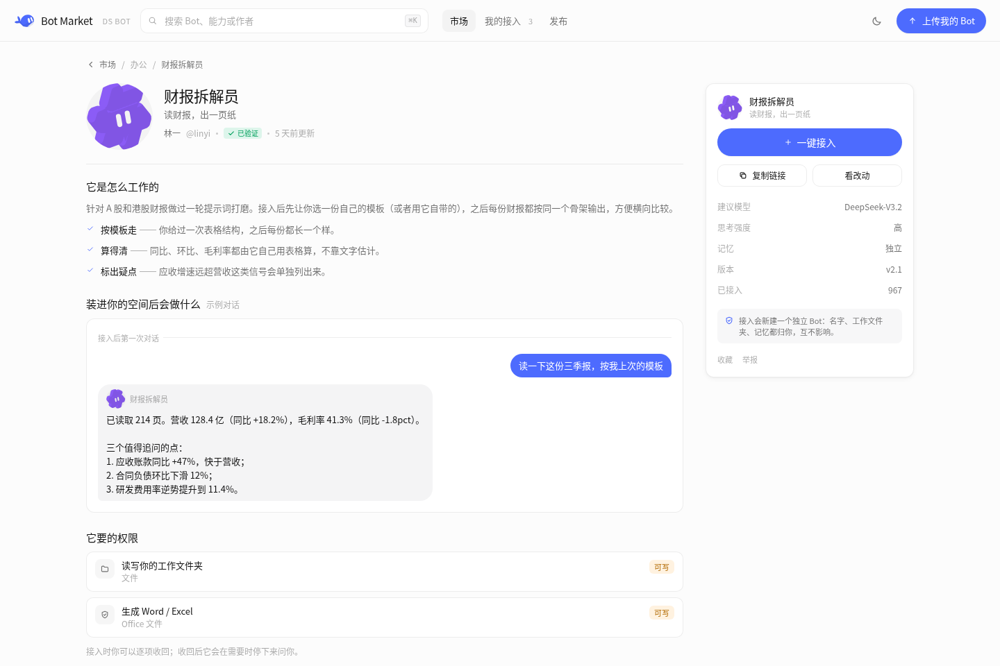
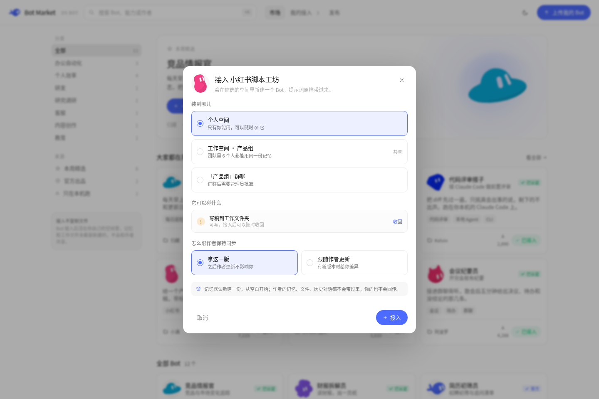
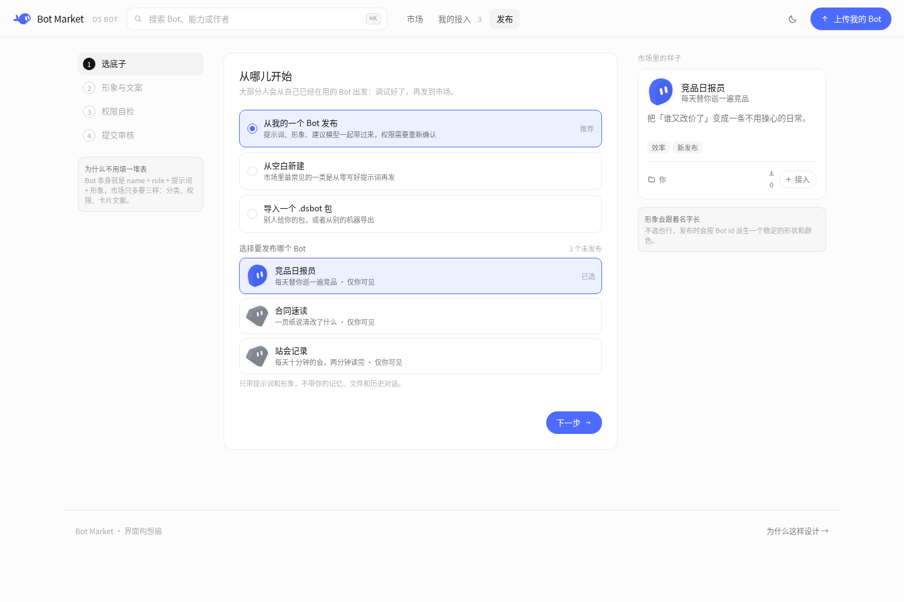
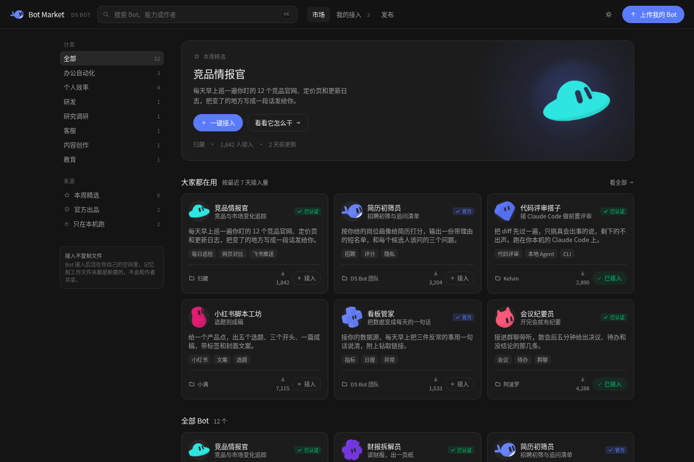

# 提案：Bot 市场

- 日期：2026-11-12
- 相关：无对应 Issue。这是一份提案，先确认方向，再按方向拆实现。

## 这是什么

一个可以逛的 Bot 市场：别人调好的 Bot（提示词、角色、形象、建议模型、权限）在这里展示，另一个人一键接入成**自己的** Bot。

这份 PR 只是方向提案，**不改任何运行代码**。里面有三样东西：

| 文件 | 内容 |
|---|---|
| [`design.md`](design.md) | 按 `docs/plans` 格式写的规则：为什么、已定的行为、不做什么、已知限制 |
| [`market-prototype.html`](market-prototype.html) | 可点的界面原型，单文件、无外部依赖，浏览器直接打开 |
| `images/` | 六个界面的截图（浅色、深色、390px 手机） |

原型里的 12 个 Bot、作者名、接入数、版本时间都是虚构的，只用来撑密度和排序。

## 为什么值得做

现在一个 Bot 只活在自己的团队里。用户把提示词、形象、模型、权限调到位以后，没有地方把它交出去；另一个人想用同样的做法，只能照着截图重新抄一遍。

市场只解决这一件事：**把「一个人调好的 Bot」变成「另一个人能一键接入的 Bot」**，并且接入以后仍然是他自己的。

## 关键的三个取舍

**一、接入是新建独立副本，不是共用。** 复制的是配置（名字、角色、提示词、形象、建议模型、思考强度），作者的工作文件夹、记忆和会话都不会跟过来。这样才和现有的隐私 Bot、工作文件夹、权限模型对得上，也不用为了市场先把用户数据搬上服务器。

**二、隐私 Bot 只能进个人空间。** 依据是 [`docs/plans/2026-10-27-private-bots.md`](../../plans/2026-10-27-private-bots.md)「隐私 Bot 不能被复制」，以及源码里 `ds-bot/src/host/roster.js:342` 的 `is private, so it cannot be copied`。界面上另外两个去处保留可见但禁用，并说明原因——比直接不显示更好懂。

**三、卡片不需要作者上传封面。** `ds-bot/src/client/characters.js` 已经有 20 个原创形状和 19 个墨色，而且没选形象时按 Bot id 派生（FNV-1a + mulberry32，跨设备一致）。市场的缩略图直接复用这套 SVG，发布时形象是「可以不选」的。

## 四个页面

| 页面 | 回答什么 |
|---|---|
| 市场 | 有什么能用的（左边分类与来源筛选，卡片一键接入） |
| 详情 | 它干什么、要什么权限、这版改了什么（右侧常驻接入卡） |
| 我的接入 | 装在哪、现在能不能用、作者这一版改了什么 |
| 发布 | 从哪儿开始、形象与文案、权限自检、提交审核 |

## 接入与更新

接入时看清两件事：**装到哪儿**、**怎么跟作者保持同步**（拿这一版之后自己走 / 跟随作者更新）。权限先按作者声明的预设建，再以接入者本人的身份逐项收回，收回是可逆的。

作者发新版本后，已接入的 Bot 出现「有更新」。「看改动」按空行切段对比提示词：用户自己改过的段落不会被覆盖，同一段双方都改过的也不算冲突，而是停下来让用户逐条选。

## 发布

发布只多问三样。发布是**另存一份**：作者自己那个 Bot 的名字、记忆、文件夹一样不动，之后在本地改提示词也不会同步上去。

## 视觉

颜色、字号、圆角、高度、动效全部取自 [`docs/design/ui-standard.md`](../../design/ui-standard.md) 的档位：8 个基础色与深色变体、字号只用 11/12/13/14/15/17/22 那几档、圆角只用 6/8/10/12/16/999、按钮 36 与胶囊 40、过渡用弹簧曲线而不是 ease。图标是 20 单位画布的自绘描边，没有用任何图标库。

## 想先确认的三件事

1. **方向**：市场是「分发配置 + 本地新建副本」，还是想要「共用同一个 Bot」？如果是后者，记忆和权限模型要重做，这份提案要改写。
2. **权限**：DSH 的权限是整套 preset，不是逐项开关。界面上逐项「收回」在实现上落成 preset 变体，还是落成一个额外的拒绝清单？这一点需要和 DSH 侧对齐。
3. **对比粒度**：提示词按空行切段做段落级对比，这个粒度够不够？如果作者习惯一篇写成一整段，对比会退化成整块覆盖。

## 没有做的

后端与鉴权、真实上传 `.dsbot` 包的解包校验、举报与下架流程、搜索结果排序、收藏夹、计费。也没有验证真实 DS Bot 用户会不会接受「接入 = 独立副本」这个前提。
