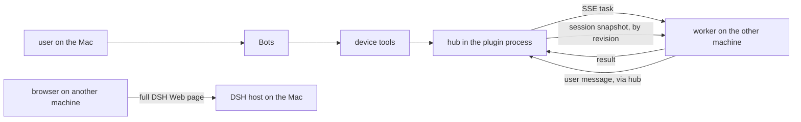

# LAN multi-device (v3)

A hub on the machine the user sits at, and a worker on another machine in the same
network. The worker dials the hub and holds one server-sent-events connection; the hub
sends one task at a time and takes back stdout, stderr, an exit code, or a file body.

Pairing also keeps the conversation aligned. The hub is the only writer of the team's
Session: a paired worker pulls a revisioned snapshot of one Bot's current chat from
`GET /session`, keeps a read replica in `sync/<botId>.json`, and sends a user message
back through `POST /session`; the hub applies it through the same `rt.sendUser` path the
browser composer uses. A waiting pull is answered when the revision changes, so another
screen trails the center by about a second. A node never runs a second DSH, never opens
the Session and never writes the team's `state.json`; after a drop it resumes from the
saved `{epoch, revision}` cursor.

The hub runs **inside the DS Bot plugin process**. Settings → Devices turns it on and
off, shows whether it is listening, lists the paired machines, makes a pairing code
with the worker command, removes a machine, copies the daemon install command and the
shared session address. A Devices strip above the sidebar account row shows how many
paired machines are online. Bots use seven tools (`list_devices`, `run_on_device`,
`device_read_file`, `device_write_file`, `device_transfer`, `device_task`,
`device_pairing_code`), so a Bot picks the machine that fits the task instead of the
user choosing per command. A worker stays a separate process on the other machine and
needs Node only — no DSH, no DS Bot. The CLI remains for debugging.



`config.multiDevice` sets the starting value only. Once the user moves the switch, the
choice in `<DSH_HOME>/bot/state.json` (`multiDevice.enabled`) wins, so an off hub stays
off after a restart. `multiDevice: false` keeps the switch out of reach.

Tasks have a `kind`: `shell` (an argument list, never a shell line), `read_file`,
`write_file` and `transfer` (`get` brings a file back, `put` sends one). An old task
with only `argv` reads as `shell`, so a previous worker keeps working.

Read-only commands (`hostname`, `whoami`, `uname`, `echo`, `pwd`, `ls`, `dir`) run
directly. Any other program, every write and every `transfer put` asks the user on the
normal DSH approval card first; a refused, cancelled or unavailable approval sends
nothing to the machine. Reads can be made approval-gated with
`multiDevice.requireApprovalForReads: true`. Files are limited to 1 MiB and live either
under the worker's `workspace/` (relative paths) or at the absolute path the user named;
`../` cannot leave the workspace.

`npm run lan:daemon -- install|uninstall|status` keeps the worker alive: a launchd agent
on macOS, a systemd user unit on Linux, a logon task plus a restart loop on Windows.
The pairing token stays in `device.json`; the install command carries no pairing code.

The same chat on both machines has two paths. Paired nodes sync through the hub (above),
with no browser. A browser on another machine can still open the center's DSH page for
the full DSH interface: that is **one DSH host with browsers on the other machines**,
not two DS Bot installations. See the plan for the thin-client path and why a second DSH
cannot attach to the same Session. The Devices page copies the shared address; when the
DSH Web server binds `127.0.0.1` it shows the `ssh -L` port-forward command instead. The
address only opens the page: the login link DSH printed at startup is the credential.
The design and the full protocol are in
[docs/plans/966-lan-multi-device.md](../../../docs/plans/966-lan-multi-device.md).

```yaml
# profile cordis.patch.yml, under the bot row
- id: bot
  name: ds-bot
  config:
    multiDevice: true    # or { host, port, name, dataDir, requireApprovalForReads }
```

```sh
# debug and status on the hub machine, inside ds-bot/
npm run lan:nodes
npm run lan:run -- --node windows-pc -- hostname

# on the worker machine
npm run lan:worker -- --hub http://192.168.1.23:8787 --code 123456 --name windows-pc
npm run lan:daemon -- install --hub http://192.168.1.23:8787 --name windows-pc
npm run lan:say -- --text "hello from this machine" --hub http://192.168.1.23:8787
```

`lan:worker` follows the Main Bot by default (`--sync main`; `--sync <id|name>` for
another Bot, `--no-sync` to run tasks only) and stores the replica under
`<dataDir>/sync/<botId>.json` with mode 0600. The daemon install command carries the
same `--sync main`.

Data lives in `~/.ds-bot/multi-device` unless `--data` or `DSBOT_LAN_DATA` says otherwise.

| File | What it holds |
|---|---|
| `pairing.js` | Pairing codes (single use, 5 minutes) and token hashing |
| `registry.js` | `nodes.json`: paired nodes, never the plaintext token |
| `policy.js` | The read-only list and the argument rules |
| `protocol.js` | Task kinds, path rules, size limits and the wire shape |
| `select.js` | Choosing a machine from a hostname, machine name or path hint |
| `hub.js` | HTTP endpoints, SSE streams, task queue, timeouts, session endpoints |
| `worker.js` | Pairing, reconnect loop, execution, file reads and writes, result delivery |
| `session-sync.js` | The center's revisioned snapshot and the one write path for a node message |
| `session-client.js` | The node's pull loop, read replica and send that a worker follows |
| `daemon.js` | launchd, systemd and Windows logon files, install and status |
| `tools.js` | The seven Bot tools and the hub's lifecycle in the plugin |
| `sse.js` | The event framing both sides share |
| `cli.js` | `hub`, `code`, `nodes`, `run`, `worker`, `say` and `daemon` |

Plain HTTP on a trusted LAN, the admin token equals local administrator, and approval
is a gate on the tool, not a sandbox on the node. The hub listens on all interfaces by
default; set `multiDevice.host` to `127.0.0.1` for local-only debugging.
