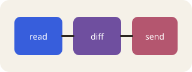

# The careful launch checklist

A long-form fixture for the Reader. It is intentionally plain Markdown: the host
must read it byte for byte, while the client renders it through the already
vetted safe Markdown path.



## Why this exists

The workbench opens real workspace files rather than copies. That sentence
matters, because the tests copy this fixture into a temporary working root and
then treat the copies as the real files under review.

## Reading flow

The Reader keeps a wide-table of contents and a narrow-panel contents button.
Refresh restores the reading position by heading and offset inside the section;
when the heading disappears, it falls back to a reasonable nearby position.

### Repeated passage

This exact sentence is repeated verbatim later in the fixture.

A selection that matches this passage more than once must not pretend it knows
one unique line number. The composer draft may quote the text, but it must leave
the precise location for the Bot to verify.

## Editing contract

The user selects a passage, writes what should change, and chooses **Add to
chat**. That action appends a draft to the composer without deleting what was
already there and without sending anything. **Send** is a separate explicit
click.

## Diff review

A Bot write through the filesystem tool supplies the host base when the after
text still matches the file on disk. External edits, shell writes, or an expired
base fall back to the client snapshot. Once the user marks a version reviewed,
that version never appears as an unread change again.

### Repeated passage

This exact sentence is repeated verbatim later in the fixture.

Because the passage occurs twice, the fixture pins down the uniqueness rule:
multiple matches mean no line numbers in the instruction.

## Boundary notes

Markdown inside code fences is not structure:

```md
## Not a real heading
```

HTML embedded in the article is inert in the Reader, and remote resources do not
load automatically. The local diagram above is the only image this fixture asks
the panel to authorize.
